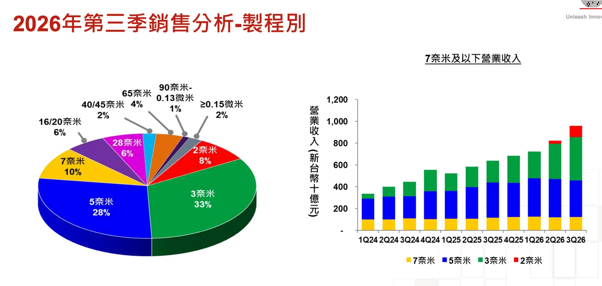
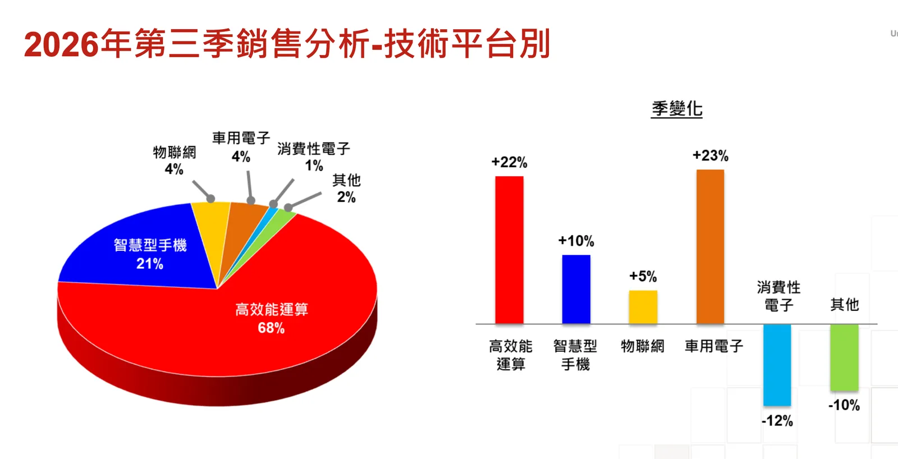

import BookmarkCard from '../../../../components/BookmarkCard.astro';
import Markmap from "../../../../components/Markmap.astro";
import { Badge } from '@astrojs/starlight/components';

* TSMC 法說/財報：<BookmarkCard href="https://investor.tsmc.com/chinese/quarterly-results/2026/q3" title="/quarterly-results/2026/q3" />
* 逐字稿（包含QA）：<BookmarkCard href="https://investor.tsmc.com/english/encrypt/files/encrypt_file/reports/2026-10/eba4fac72873bf546b669bd2b5d973df5c93215d/TSMC%203Q26%20Transcript.pdf" />
* QA有人整理，數據帶「市場共識」：<BookmarkCard href="https://tw.fiisual.com/blog/post/2026/tsmc-2026-q3-earnings-call-memo" />

Q3 date: 10/15

:::tip[閱畢測驗 TEST！]

Q1：車用電子在 2Q26 與 3Q26 的營收占比都顯示為 4%，為何營收 QoQ 仍可成長 23%？

占比是各季車用營收除以當季總營收，且表格已四捨五入；QoQ 比較的是車用營收金額。總營收和實際占比都可能變動，因此兩季都顯示 4%，車用營收仍可成長 23%。

Q2：台積電提到的 AI 加速器成長率，是否包含代理式 AI 帶動的伺服器 CPU 需求？

不包含。台積電維持狹義的 AI 加速器定義，因難以區分傳統伺服器 CPU 與 AI 伺服器 CPU。CPU 需求雖是業務的一部分，不能直接算進該成長率。

Q3：海外廠毛利率稀釋預估達 3–4 個百分點，是否就能斷定亞利桑那第二期或第三期會加速投產？

不能。這是海外廠整體對毛利率的預估影響，台積電並未藉此確認亞利桑那特定廠期的投產時程；仍須觀察各廠建置與產能爬坡進度。

:::

---

> 各類營收佔比（依應用）

| 營收占比（應用） | 3Q26 | 2Q26 | QoQ |
| :---: | :---: | :---: | :---: |
| **高效能運算** | 68% | 66% | 22% |
| **智慧型手機** | 21% | 22% | 10% |
| **物聯網** | 4% | 5% | 5% |
| **車用電子** | **4%** | **4%** | **23%** |
| **消費性電子** | 1% | 1% | (12%) |
| **其他** | 2% | 2% | (10%) |

因為表格的 4% 是車用營收占總營收的比重，且經過四捨五入；QoQ 23% 是車用營收金額的成長率。兩者的分母不同。

例如，若 2Q 總營收是 100、車用營收是 3.8，車用占比會顯示為 4%。到了 3Q，總營收增至 118、車用營收增至 4.674，車用營收就成長了 23%，但占比是 4.674 ÷ 118 ≈ 3.96%，表格仍會顯示為 4%。

## Q&A

---

Q1： 在 AI 半導體需求日益積極的情況下，台積電如何看待 AI 營收類別的成長？如何調和客戶產能需求與資料中心電力供應、資金、HBM、先進封裝、網路雷射等潛在瓶頸的疑慮？若這些限制造成半導體供應與實際 AI 發展的落差，**台積電將如何調整產能分配與策略，以降低供應鏈過度建設的風險**？另，先前指引的 AI 加速器 CAGR 是否有更新？

* *加速器（AI 加速器）：專為 AI 訓練或推論運算設計的晶片，例如 GPU 或客製化 ASIC。*

* *CAGR（年複合成長率）：把一段期間的總成長換算成每年固定成長的比率，用來比較長期成長速度。*

`專業投資人想確認 AI 訂單能否隨資料中心實際建置轉化為營收，並觀察需求成長是否足以支撐擴產、避免供應鏈過度建設。`

> 我們有非常精密且紀律嚴明的產能規劃流程，已把 CSP 的資本支出、資料中心建置進度、電力供應、其他零組件供應等所有可能性**都納入考量**，並自行判斷。目前評估結果仍顯示**需求高於供給**，我們正全力縮小缺口。AI 需求極度強勁，未見放緩跡象，先前的中高 50% CAGR 可能會更高。

---

Q2： 在強勁需求與高資本支出循環下，台積電計畫約 2030 年導入 High-NA EUV，這是否會進一步提升生產力、加速長期營收成長？資本支出強度提高後，應如何看待**定價能力、長期毛利率與資本效率報酬**？

* *High-NA EUV（高數值孔徑極紫外光微影）：使用更高數值孔徑鏡頭的曝光設備，可印製更細微的晶片線路。*

`專業投資人想判斷新設備帶來的生產力與售價提升，能否抵銷資本支出及折舊增加，維持長期毛利率與投資報酬。`

> High-NA 是很好的工具，我們計畫 2030 年使用，屆時生產力會比現在高很多。台積電獲利沒有天花板，但大幅提升不會一夕發生。我們的策略是與客戶合作，讓他們成功，我們再分享價值。

---

Q3： 明年短缺情況是否會比 2026 年更嚴重？台積電過去約十年晶圓產能年增幅多在中高個位數，在這波加速擴產下，未來幾年晶圓產能成長**是否可能接近或超過 10%**？

`專業投資人想看先進製程擴產能否追上需求，以及供需缺口會擴大還是收斂，藉此判斷未來出貨成長與議價能力。`

> 需求極度強勁且持續升高，供需缺口仍相當大，我們正全力增加產能。客戶需求還在持續上修，目前無法判斷缺口會變大還是縮小。每年產能增加數字或許不大，但先進節點的增加才是主要驅動力；**現在談未來產能成長百分比還太早**。

---

Q4： 海外擴張是否更積極？最近有德州新廠群與某客戶合作的討論，合作框架與原則是否類似日本 JASM 或 ESMC？

* *JASM：台積電與日本夥伴合資、設於熊本的晶圓廠；ESMC：台積電與歐洲夥伴合資、設於德國德勒斯登的晶圓廠。*

`專業投資人想追蹤海外擴產的地點、客戶合作方式與投資速度，評估新產能能否取得穩定訂單，以及海外建廠對成本和毛利率的影響。`

> 美國是擴產重點，因大客戶多在此，且美國政府支持。我們已把產能評估範圍擴大至亞利桑那以外，德州是其中之一，並已派團隊評估。也與某客戶討論是否可利用其額外產能。無論形式如何，**廠房必須由台積電營運**。

---

Q5： 部分客戶提到**次級晶圓市場，這是很小一部分業務、特定客戶行為，還是新興趨勢**？台積電是否允許？

`專業投資人想知道**產能轉手**是否開始普遍化，藉此分辨客戶預訂產能是實際生產需求，還是短期囤積與轉售，並觀察台積電能否掌握產能分配。`

> 這不是新策略。台積電原則上**不允許客戶轉租或拍賣產能**。僅在少數情況下，客戶可透過光罩授權協議合作，但這**非常態，金額非常小**。

---

Q6： 台積電計畫 2030 年才導入 High-NA EUV，部分**競爭對手已較早採用，這是否造成技術領先劣勢**？

* *High-NA EUV（高數值孔徑極紫外光微影）：使用更高數值孔徑鏡頭的曝光設備，可印製更細微的晶片線路。*

`專業投資人想確認設備導入時點是否影響製程競爭力，並觀察台積電能否在技術成熟度、量產成本與客戶需求之間維持優勢。`

> 我們評估新工具時，要求最佳技術、合理成本與**最高成熟度**。2030 年導入是因屆時 High-NA 會更成熟、成本更合理，並正與 ASML 合作 2031 年建立 12 吋光罩。較晚導入並非劣勢，我們有信心持續提供客戶最先進的技術。

---

Q7： 某 IDM 客戶資本支出積極，是否可能更多自製而減少委外？先前說 A14 可能比 N2 更大，是否已假設該 IDM 會在 A14 委外更多伺服器 CPU？

* *A14：台積電繼 N2 之後的新一代先進邏輯製程。*

* *N2：台積電的 2 奈米製程，採用奈米片電晶體，是 A14 的前一技術世代。*

`專業投資人想判斷大型客戶的自製產能會否排擠台積電訂單，以及 A14 的成長是否已有足夠多元的客戶需求支撐。`

> 我們對所有客戶一視同仁，並已把其內部產能納入考量。**A14 的客戶活動已高於 N2，預期會成為比目前 N2 更大的節點。不評論特定客戶的委外計畫**。

---

Q8： 先進封裝方面，客戶 reticle size 越來越大，CoWoS 3.5D 等方案能否跟上？若客戶先選競爭對手卻無法滿足需求，台積電是否願意作為備援支援？

* *reticle size（光罩尺寸）：以光罩單次曝光可涵蓋的面積為基準；此處的 5X、9X 等數字，表示封裝中介層面積約為該基準的幾倍。*

* *CoWoS（晶片於晶圓上、再置於基板上）：台積電的先進封裝技術，可把運算晶片與高頻寬記憶體等元件整合在同一封裝中。*

`專業投資人想看台積電能否支援更大尺寸的 AI 晶片封裝，並從交期、技術能力與競爭方案的表現判斷先進封裝市占及營收成長空間。`

> 台積電先進封裝技術極具競爭力，首要目標是協助客戶產品順利上市。目前已量產 5X reticle size，客戶非常滿意；正開發 9X 與 14X。CoWoS 仍是客戶首選，我們也持續優化成本。若競爭方案無法交貨，客戶產品順利上市是我們第一優先。

---

Q9： 2026 年後的**資本支出**如何看待？是否會比營收成長更快、持平或較慢？工具價格通膨是否也會推升 2027 年 CapEx？

`專業投資人想比較資本支出與營收的成長速度，確認擴產是否帶來足夠回報，並觀察設備漲價會否壓縮自由現金流與未來獲利。`

> 現在談 2026 年後具體數字還太早，但我們對 AI 大趨勢有強烈信念，**2026–2028 年 CapEx 將顯著高於過去三年，以支援客戶成長，不留下任何機會給他人**。工具、材料、人力成本通膨確實存在，但多數 CapEx 仍與長期需求相關。若執行得當，營收成長仍可超過 CapEx 成長。

---

Q10： 海外廠房稀釋從 2027 年起擴大至 3–4%，是否意味亞利桑那**第二期或第三期**以後產能加速？

* *海外稀釋：海外晶圓廠興建與投產初期成本較高，使台積電整體毛利率降低；此處的 3–4% 指約 3–4 個百分點。*

* *亞利桑那第二期或第三期：台積電在美國亞利桑那州的第二座與第三座晶圓廠擴建階段。*

`專業投資人想從海外廠對毛利率的稀釋幅度，推估新廠投產與爬坡速度，並觀察海外擴產的成本壓力何時加重。`

> 我們正用盡一切手段、盡快增加產能。先前已說過五年期後段海外稀釋會達 3–4 個百分點，目前仍維持此看法。

---

Q11： AI 需求結構是否正從加速器轉向更高效能的解決方案？對台積電**製造與封裝業務**的增量機會如何？

* *加速器（AI 加速器）：專為 AI 訓練或推論運算設計的晶片，例如 GPU 或客製化 ASIC。*

`專業投資人想辨識 AI 需求是否**從加速器擴散到 CPU **等產品，進而推估先進製程與封裝的新增訂單來源及成長廣度。`

> 無論加速器或 CPU 端，需求都極度強勁。代理式 AI CPU 需求確實持續增加，這是目前趨勢，但**其他領域同樣非常強勁**。我們判斷需求仍遠高於目前供給能力，正全力縮小缺口。

---

Q12： 未來節點同時支援傳統供電與超級電源軌雙架構，是否讓**良率學習曲線更困難、製造複雜度提高，進而影響毛利率**？

`專業投資人想知道雙架構量產會否拖慢良率提升、增加製造成本，並觀察不同客戶需求能否在同一節點有效轉化為獲利。`

> 現在情況與過去不同，手機小晶片與 AI/HPC 大晶片需求同時出現，這其實是台積電的優勢。我們已為此做好準備，目前結果優異，客戶滿意，學習曲線表現合理。

---

Q13： 電力供應限制是否曾導致客戶下修預測？**電力越來越緊是否會加速客戶採用超級電源軌技術以提升每瓦效能**？

`專業投資人想確認資料中心缺電會否使客戶延後晶片訂單，並觀察電力效率需求是否推動背面供電技術的採用。`

> 電力供應是我們評估的重要因素之一，因此特別查核美國資料中心與電力狀況，目前回饋良好。這並未改變客戶採用背面供電的決策；是否使用取決於產品本身需求。

---

Q14： 先前 AI 加速器 CAGR 是否已包含代理式 AI CPU？若客戶大幅上修 CPU 預測，何時會更新 AI 需求成長數字？

* *加速器（AI 加速器）：專為 AI 訓練或推論運算設計的晶片，例如 GPU 或客製化 ASIC。*

* *CAGR（年複合成長率）：把一段期間的總成長換算成每年固定成長的比率，用來比較長期成長速度。*

`專業投資人想釐清 AI 成長指標涵蓋哪些產品，避免把 CPU 需求誤算進加速器預測，並評估指標之外的 AI 營收成長空間。`

> 不包含。我們維持狹義的 AI 加速器定義，因難以區分傳統伺服器 CPU 與 AI 伺服器 CPU，也取決於客戶應用與配置。它確實是我們業務的一部分，但目前仍沿用原本狹義定義。
