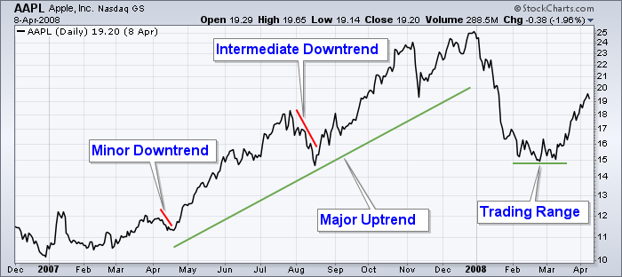
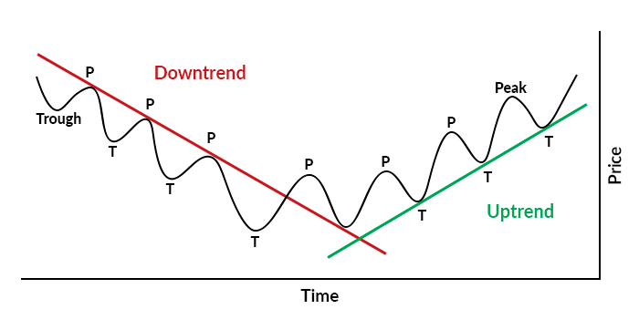
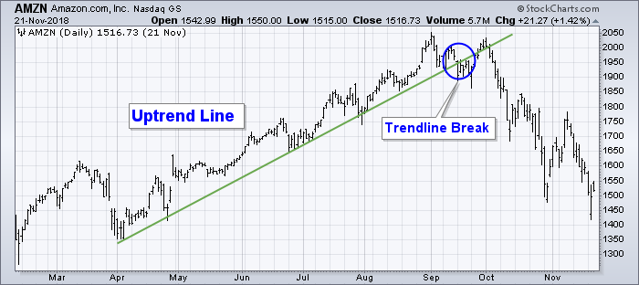
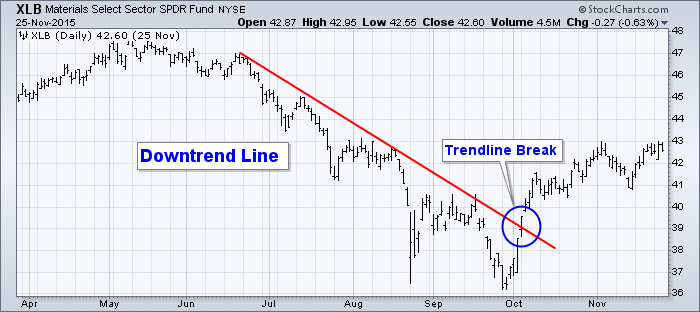

import BookmarkCard from '../../../../components/BookmarkCard.astro';

source: <BookmarkCard href="https://chartschool.stockcharts.com/table-of-contents/overview/technical-analysis-101/ta-101-part-8" title="ChartSchool：TA 101 – Part 8" />

---

:::tip[閱畢測驗 TEST！]

Q1：畫上升趨勢線與下降趨勢線時，分別應該連接波峰（高點）還是波谷（低點）？各自扮演什麼角色？

**A**：上升趨勢線呈正斜率，連接兩個（或以上）逐步墊高的**低點（波谷）**，扮演**支撐**角色；下降趨勢線呈負斜率，連接兩個（或以上）逐步走低的**高點（波峰）**，扮演**壓力**角色。

Q2：只要在圖上找到兩個低點連成一條直線，就代表這是一條已被市場充分驗證的有效上升趨勢線嗎？

**A**：還不算充分驗證。前兩個點只是用來**建立（establish**）趨勢線，必須在後續出現更多價格觸及並獲得支撐的點，才能**驗證（validate**）這條趨勢線的有效性。

Q3：某檔股票近三個月的波峰都落在 50 元附近，波谷都落在 45 元附近，這段走勢應歸類為哪種型態？

**A**：**盤整區間（Trading Range）**。上升趨勢需要波峰與波谷持續墊高，下降趨勢則是波峰與波谷持續走低；當波峰與波谷大致呈水平排列時，即屬於盤整區間。

Q4：一檔股票過去 8 個月沿著上升趨勢線走高，最近 3 週拉回下跌，但價格仍維持在該上升趨勢線之上。這代表原本的長期上升趨勢已經反轉了嗎？

**A**：還不能這樣判定。持續 8 個月（超過 6 個月）屬於**長期趨勢（Major）**，而 3 週（少於 1 個月）的回檔屬於**短期趨勢（Minor）**，同一檔標的本就可能同時存在不同層級的反向趨勢（如文中 AAPL 範例）。只要價格仍維持在長期上升趨勢線之上，該上升趨勢便仍視為完好；不過若是短期投資人，仍須留意這段短期下跌帶來的風險。

Q5：股價向上突破一條下降趨勢線後，能直接斷定「空頭徹底結束、接下來必定展開大漲」嗎？

**A**：不能。價格向上突破下降趨勢線，表示市場供給減少、恐懼與貪婪的平衡正在改變，趨勢**可能**即將反轉，但並不能保證立刻大漲。突破後走勢也可能先轉為**盤整區間**（波峰與波谷呈水平排列），或再度轉弱；仍須觀察後續是否形成逐步墊高的波峰與波谷，並搭配新趨勢線的建立與驗證來確認。

:::

## 趨勢心理（Trend Psychology）

* **市場心理決定方向**：市場參與者的恐懼與貪婪心理最終決定價格走向——貪婪（需求）推升價格上漲，恐懼（供給）壓低價格下跌。
* **趨勢的本質**：價格趨勢是一段持續且具方向性的價格移動，可以想像成**傾斜的支撐／壓力區**。
* **延續與反轉**：只要恐懼或貪婪其中一方持續主導市場，趨勢就會延續；當兩者的力道平衡改變時，趨勢就會減弱或改變方向。
* **趨勢速度**：價格上漲或下跌的快慢，反映出市場當下貪婪或恐懼的程度。

## 趨勢的類型與週期（Trending）

依波峰（Peak）與波谷（Trough）的相對位置，價格走勢可分為三種型態：

* **上升趨勢（Uptrend）**：波峰與波谷持續墊高。
* **下降趨勢（Downtrend）**：波峰與波谷持續走低。
* **盤整區間（Trading Range）**：波峰與波谷大致呈水平排列。

依持續時間長短，趨勢一般可分為三個層級：

* **長期趨勢（Major）**：超過 6 個月。
* **中期趨勢（Intermediate）**：1 至 6 個月。
* **短期趨勢（Minor）**：少於 1 個月。

長期投資人通常較關注長期趨勢的辨識；短期投資人則更重視短期與中期趨勢。

上圖以蘋果（AAPL）日線為例，呈現同一檔標的可同時存在不同層級的趨勢：在 2007 年的長期上漲趨勢（綠線）過程中，仍夾雜短期與中期的下跌回檔（紅線）；2008 年初轉跌後，則在 15 美元附近形成水平盤整區間。

## 趨勢線（Trend Lines）

* **定義**：趨勢線是連接兩個（或以上）價格高點或低點，並向未來延伸的直線，用來作為支撐線或壓力線。
* **建立與驗證**：前兩個點用來**建立（establish）**趨勢線，後續更多的觸及點則用來**驗證（validate）**這條線的有效性。

圖中的 **P（Peak）為波峰，T（Trough）為波谷**。

### 上升趨勢線（Uptrend Line）

* **畫法與斜率**：呈**正斜率**，連接兩個（或以上）逐步墊高的低點。
* **功能**：扮演**支撐**角色；只要價格維持在趨勢線之上，上升趨勢便視為完好。
* **跌破訊號**：價格跌破上升趨勢線，代表市場需求轉弱，趨勢可能即將反轉。

### 下降趨勢線（Downtrend Line）

* **畫法與斜率**：呈**負斜率**，連接兩個（或以上）逐步走低的高點。
* **功能**：扮演**壓力**角色；只要價格維持在趨勢線之下，下降趨勢便視為完好。
* **突破訊號**：價格向上突破下降趨勢線，代表市場供給減少，趨勢可能即將反轉。

---

本文四張圖片均出自 StockCharts ChartSchool 的〈TA 101 – Part 8〉。下一章將介紹趨勢通道（Trend Channels）與趨勢反轉（Trend Changes）。
