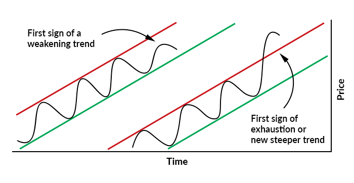
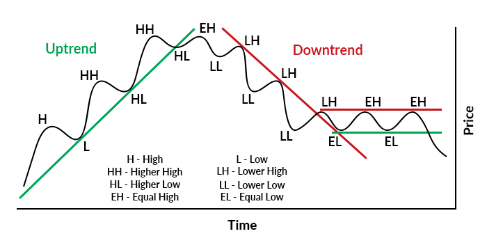
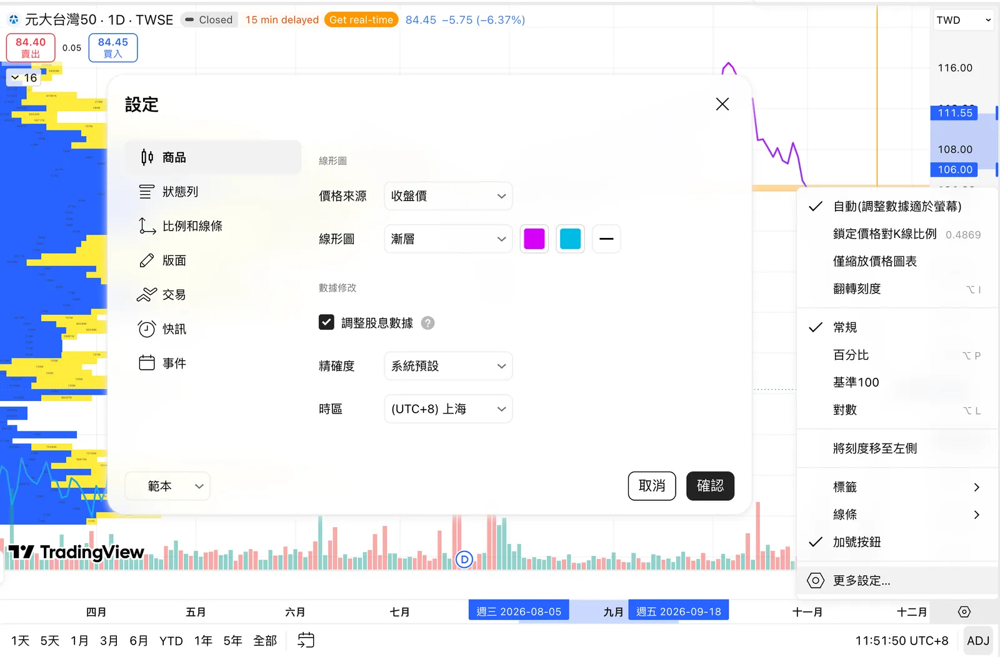

import BookmarkCard from '../../../../components/BookmarkCard.astro';

source: <BookmarkCard href="https://chartschool.stockcharts.com/table-of-contents/overview/technical-analysis-101/ta-101-part-9" title="ChartSchool：TA 101 – Part 9" />

---

:::tip[閱畢測驗 TEST！]

Q1：在上升價格通道中，股價突然向上突破上緣通道線，能直接解讀成「多頭加速、只會越漲越高」嗎？

**A**：不能。價格突然突破上升通道上緣可能代表兩種截然不同的情況：一是正展開一段**更陡峭的新上升趨勢**，另一則是原有漲勢開始**力竭並準備反轉**，不能單憑突破上緣就斷定必定續漲。

Q2：價格明明還在上升通道內、也沒有跌破下緣趨勢線，但最新一波上漲卻碰不到上緣通道線，這透露什麼警訊？

**A**：代表原本的上升趨勢可能正在**減弱**，並可能是準備反轉的早期訊號。這也是同時畫出上下兩條平行趨勢線，用來追蹤價格在通道內運作是否穩定的原因。

Q3：一檔股價 100 元的股票在除息日發放 5 元現金股利，未調整線圖上股價直接降到 95 元。為什麼技術分析師通常會看「經調整」的價格圖表？

**A**：因為這 5 元的價差（100 元 → 95 元）來自除息造成的價格變動，而非單純的市場看空賣壓；若使用未經還原調整的價量資料，技術指標的計算會受到干擾，因此通常以調整後的資料為準。

Q4：一檔原本走上升趨勢的股票，過去依序形成波峰 100 → 波谷 90 → 波峰 110 → 波谷 102，接著反彈只漲到 109 元就回落。光憑這個 109 元的高點就已「確認」反轉了嗎？之後要出現什麼價格才算確認？

**A**：還沒確認，這只是反轉的**開始**。109 元低於前一個波峰 110 元（形成更低高點 LH），打破了原本「更高高點（HH）」的規律；但須等下一個波谷**相近於或低於前一個波谷 102 元**（EL 或 LL），才算**確認**趨勢反轉。此外，反轉後也可能先進入盤整區間，未必立刻轉為下降趨勢。

Q5：承上題的判讀方式，若在 TradingView 關閉右下角 `ADJ`（未勾選「調整股息數據」）的未調整圖表上，看到某高配息標的在除息日當天創下更低低點（LL），能直接認定趨勢已確認反轉為空頭嗎？

**A**：不能直接認定。未調整圖表在除息或配發當日會因股利金額而直接向下跳價，這個「更低低點」可能是配息造成的資料落差，而非市場趨勢真正轉弱。應先開啟 **`ADJ`（調整股息數據）**切換回經股利還原的價格圖表，檢視波峰與波谷結構（如 EH/LH 與 EL/LL）是否仍符合反轉條件，再做判斷。

:::

## 價格通道（Price Channels）

* **通道的形成與觀察**：具趨勢性的價格常在上下兩條**平行的趨勢線**之間波動，形成價格通道。此時可同時畫出上緣與下緣趨勢線，持續觀察價格是否穩定維持在通道內。
* **未能觸及上緣（轉弱訊號）**：在上升通道中，若價格反彈卻**無法觸及上緣通道線**，代表上升趨勢可能正在減弱，並準備反轉。
* **突然突破上緣（力竭或加速）**：在上升通道中，若價格突然**向上突破上緣通道線**，可能意味著兩種情況之一——原有漲勢開始力竭並準備反轉，或是展開一段**更陡峭的新趨勢**。
* **下降通道同理**：下降趨勢的價格通道也會出現相呼應的行為（跌不到下緣代表跌勢可能減弱；突然跌破下緣可能是力竭反轉或加速下跌）。

## 趨勢反轉（Trend Changes）

* **趨勢的三種去向**：具趨勢性的價格只能往三個方向發展——**延續原趨勢**、**轉為盤整區間**，或**反轉為相反趨勢**。
* **用波峰與波谷判讀**：觀察價格高點（波峰）與低點（波谷）的變化，是最容易辨識趨勢反轉的方式：
  * **上升趨勢**：不斷創下更高的高點（HH）與更高的低點（HL）。
  * **下降趨勢**：不斷出現更低的高點（LH）與更低的低點（LL）。
  * **盤整區間**：高點（EH）與低點（EL）隨時間大致維持在相近水準。
* **上升趨勢反轉的兩階段**：
  * **反轉開始**：新的高點與前一個高點相近（EH）或更低（LH）。
  * **反轉確認**：下一個低點與前一個低點相近（EL）或更低（LL）。
* **下降趨勢與盤整區間同理**：當新的波峰或波谷打破原本的高低點規律，並由下一個波峰或波谷加以確認時，就代表趨勢發生轉換。

圖中縮寫對照：**H / L** 為高點／低點、**HH / HL** 為更高高點／更高低點、**LH / LL** 為更低高點／更低低點、**EH / EL** 為相近高點／相近低點。

## 價量資料調整（Price and Volume Data Adjustments）

* **為什麼需要資料調整**：當公司發放股利（dividend）或基金進行配息／分配（distribution）時，會直接影響標的價格——例如公司除息日（ex-dividend date）當天，股價會依股利金額下跌。因此必須對價格與成交量資料進行還原調整，技術指標的計算才會有效。
* **技術分析的慣例**：技術分析師通常會查看**經過調整（還原）的價格圖表**。

* **如何在 TradingView 開啟／切換調整資料**：
  * **右下角一鍵切換（最快）**：在超級圖表（Supercharts）右下角（與 `對數 / log`、`自動 / auto` 同一排），點擊 **`ADJ`** 按鈕；亮起代表已做除息還原調整，熄滅則為未調整除息。
  * **從圖表設定開關**：點擊圖表右上角**齒輪（設定）**（或雙擊右側價格座標軸）→ 左側切換到**「商品」（Symbol）**分頁 → 勾選或取消**「調整股息數據」（Adjust data for dividends）**。
  * **注意事項**：TradingView 預設會自動還原股票分割（Splits），但**股息調整（`ADJ`）預設通常為關閉**，觀察高股息個股或 ETF（如 0050、0056、SPY）的長期趨勢時建議確認已開啟；期貨、外匯、加密貨幣等無配息商品則不會顯示此選項。

---

本文兩張圖片均出自 StockCharts ChartSchool 的〈TA 101 – Part 9〉。下一章將介紹如何以成交量驗證趨勢反轉訊號。
