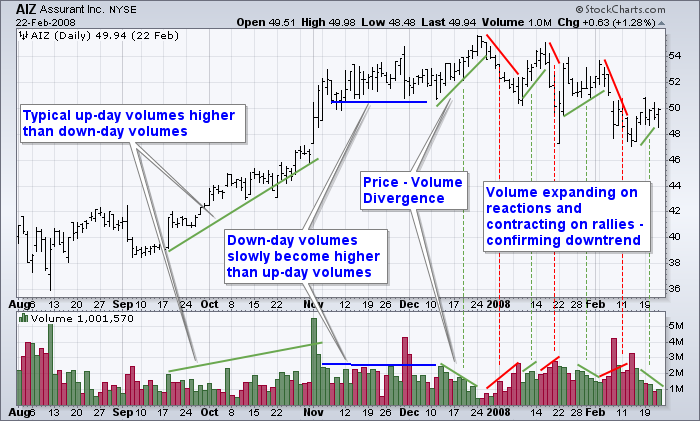

import BookmarkCard from '../../../../components/BookmarkCard.astro';

source: <BookmarkCard href="https://chartschool.stockcharts.com/table-of-contents/overview/technical-analysis-101/ta-101-part-10" title="ChartSchool：TA 101 – Part 10" />

---

:::tip[閱畢測驗 TEST！]

Q1：在上升趨勢與下降趨勢中，成交量分別應該呈現什麼變化，才算「驗證」目前的趨勢？

**A**：在**上升趨勢**中，價格上漲時成交量應放大、拉回時萎縮；在**下降趨勢**中則相反，價格下跌時成交量應放大、反彈時萎縮。只要維持這種「順勢放量、逆勢縮量」的節奏，就代表成交量正在驗證當前趨勢。

Q2：什麼是上升趨勢中的「負背離（Negative Divergence）」與下降趨勢中的「正背離（Positive Divergence）」？

**A**：**負背離**指上升趨勢中價格再創新高，但成交量卻萎縮，透露買盤力道正在減弱；**正背離**指下降趨勢中價格再創新低，但成交量反而萎縮，若隨後反彈時放量，代表價格可能開始盤整或反轉向上。

Q3：一檔股票處於上升趨勢，最近創下新高時成交量卻明顯比前一波少，接著拉回下跌時成交量反而放大。這組量價組合透露什麼訊號？可以直接斷定「馬上會進入空頭」嗎？

**A**：創新高量縮屬於**負背離**，代表買盤壓力減弱；接著拉回時放量，更顯示賣壓增強，是趨勢可能轉弱的警訊。但仍不能直接斷定必定立刻進入空頭——依文中說明，這類現象出現後，價格可能先轉為**盤整**，也可能反轉為下降趨勢，仍須搭配後續走勢與量價節奏確認。

Q4：一檔處於下降趨勢的股票，某波反彈上漲時成交量明顯放大，但隨後再次跌破前低時成交量卻比前幾波下跌都小。這偏向「確認下降趨勢延續」，還是「下降趨勢可能轉弱的警訊」？

**A**：偏向**下降趨勢可能轉弱的警訊（正背離）**。確認下降趨勢的量能節奏應是**下跌放量、反彈縮量**；這檔股票卻呈現反彈放量、創低量縮，符合下降趨勢的**正背離**特徵，代表價格可能開始進入盤整或反轉為上升趨勢（仍須觀察後續確認，不能視為必然反轉）。

:::

## 成交量驗證（Volume Confirmation）

* **上升趨勢的量能驗證**：在上升趨勢中，價格**上漲時成交量應放大、拉回時成交量應萎縮**；只要維持這個節奏，就代表成交量正在驗證上升趨勢。
* **下降趨勢的量能驗證**：在下降趨勢中則相反，價格**下跌時成交量應放大、反彈時成交量應萎縮**，藉此確認下降趨勢仍在延續。
* **上升趨勢的負背離（Negative Divergence）**：
  * 當上升趨勢中的價格再創新高，但成交量卻反而下降，即出現**負背離**，顯示市場的買盤力道（buying pressure）正在減弱。
  * 如果接著在**價格拉回時成交量開始放大**，價格便可能轉為**盤整**，或反轉進入下降趨勢。
* **下降趨勢的正背離（Positive Divergence）**：
  * 相同概念也適用於下降趨勢：若價格再創新低時**成交量開始萎縮**，且在**反彈時成交量放大**，價格便可能開始**盤整**，或反轉進入上升趨勢。

上圖以 Assurant（AIZ）日線圖完整示範趨勢轉換過程中的量能變化：

1. **上升趨勢驗證（2007 年 9 月中～11 月初）**：上漲日成交量普遍高於下跌日，且隨價格上攻量能同步放大。
2. **高檔籌碼鬆動（2007 年 11 月中～12 月上旬）**：價格在藍線區間橫盤整理時，下跌日成交量逐漸超過上漲日。
3. **價量負背離（2007 年 12 月中下旬）**：價格再創波段新高，下方成交量卻明顯下滑，出現 `Price - Volume Divergence`。
4. **下降趨勢驗證（2008 年 1 月～2 月）**：價格轉跌後，每次下跌（紅線）伴隨成交量放大、反彈（綠線）時成交量萎縮，確認進入下降趨勢。

---

本文圖片出自 StockCharts ChartSchool 的〈TA 101 – Part 10〉。至此「趨勢與趨勢線」單元告一段落，下一章將進入由兩條趨勢線共同構成的基礎價格型態（Price Patterns）。
