import BookmarkCard from '../../../../components/BookmarkCard.astro';
import MermaidDiagrams from '../../../../components/MermaidDiagrams.astro';

<MermaidDiagrams />

source: <BookmarkCard href="https://chartschool.stockcharts.com/table-of-contents/overview/technical-analysis-101/ta-101-part-5" />

---

未來延伸閱讀：

* <BookmarkCard href="https://chartschool.stockcharts.com/table-of-contents/chart-analysis/candlestick-charts/introduction-to-candlesticks" title="ChartSchool：K 線的資訊、限制與趨勢背景" />
* <BookmarkCard href="https://www.cfainstitute.org/insights/professional-learning/refresher-readings/2026/market-based-valuation-price-enterprise-value-multiples" title="CFA Institute：以獲利、現金流等基本面衡量估值" />


:::tip[閱畢測驗 TEST！]
<details>
<summary>Q1：今天收盤高於昨天，K 線一定是空心嗎？</summary>
不一定。空心與實心比較的是當期收盤與開盤；外框及影線顏色才比較收盤與昨收。
</details>

<details>
<summary>Q2：昨收 100 元、今開 110 元、今收 105 元，該怎麼解讀？</summary>
依本文配色為黑色實心：相對昨收上漲，盤中卻由開盤價回落。若出現在一段漲勢之後，可能透露買盤轉弱。
</details>

<details>
<summary>Q3：長下影線表示什麼？</summary>
價格曾明顯下探，之後回升，可能透露買盤承接；仍須結合趨勢判讀。
</details>

<details>
<summary>Q4：看到放量長下影線，就能認定「主力進場護盤，明天一定漲」嗎？</summary>

**不能，價格現象不等於買方身分，更不保證隔日上漲。** 長下影線只顯示價格曾下探，之後收回部分跌幅；成交量放大也無法單獨證明是某個主力在護盤。同樣的形狀出現在下跌後或長期上漲後，意義可能不同，還需結合趨勢、關鍵價位與後續走勢判讀。把「出現承接」直接推論成「主力吸貨、即將大漲」，就是替圖表補上它沒有提供的故事。

延伸閱讀：<BookmarkCard href="https://chartschool.stockcharts.com/table-of-contents/chart-analysis/candlestick-charts/introduction-to-candlesticks" title="ChartSchool：K 線的資訊、限制與趨勢背景" />

</details>

<details>
<summary>Q5：股價從 120 元跌到 60 元，已經「打五折」，是不是比較便宜、買進也比較安全？</summary>

**價格比以前低，不代表估值更便宜，也不代表風險更小。** 

例如股價 120 元、每股盈餘 10 元時，本益比是 12 倍；若股價跌到 60 元，假設公司獲利也惡化，最近 12 個月的 EPS 從 10 元降到 2 元，本益比反而升至 30 倍。

這個假設例子說明，股價下跌時，公司獲利也可能惡化，不能只拿過去高點當作合理價值。是否低估仍需評估未來獲利、成長與風險；「跌很多」本身不是買進理由，K 線也無法單獨回答公司值多少錢。


PE = 股價 (Price) ​／ 每股盈餘 (EPS) 


延伸閱讀：<BookmarkCard href="https://www.cfainstitute.org/insights/professional-learning/refresher-readings/2026/market-based-valuation-price-enterprise-value-multiples" title="CFA Institute：以獲利、現金流等基本面衡量估值" />

</details>
:::

## K 線圖：看懂價格與買賣力道

K 線與 OHLC 棒形圖都呈現開盤、最高、最低、收盤價，但更容易辨識開收盤關係。

- **實體**：連接開盤與收盤；越長，代表當期價格移動越大。
- **影線**：延伸至最高與最低價；長下影線可能偏多，長上影線可能偏空，反映價格曾大幅移動後折返。

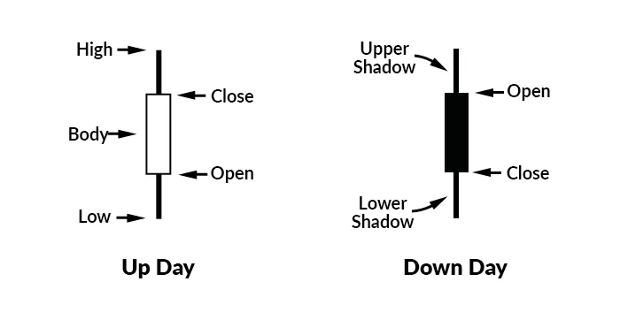

:::note[蝸牛補充：]
上面這裡，白表「陽線 (+)」，黑表「陰線 (-)」

- 台股：紅「陽線」↗️，綠(黑)「陰線」↘️
- 美股：紅(黑)「陰線」↘️，綠「陽線」↗️

黑Ｋ → 陰線
:::

### 小考：把一天的價格折線濃縮成一根 K 線

以下折線都是**同一交易日的示意價格路徑**，假設途中沒有其他更高或更低的價格；不是把多天的收盤價連起來。一般每日收盤價折線缺少當日開盤與高低價，無法單憑它還原 K 線。

每題先找 **O（開盤）、H（最高）、L（最低）、C（收盤）**，再判斷：

1. 收盤高於開盤是空心，低於開盤是實心。
2. 開收盤之間畫實體；實體之外才畫上下影線。

這裡先練形狀，暫不加入昨收與紅黑配色。答案中的 K 線為結構示意，不按價格比例繪製。

#### 第 1 題：一路走高

價格依序為 **100 → 102 → 105 → 108 → 110**。實體是空心還是實心？有影線嗎？

```mermaid
xychart-beta
    x-axis ["開盤", "時段一", "時段二", "時段三", "收盤"]
    y-axis "價格" 95 --> 115
    line [100, 102, 105, 108, 110]
```

<details>
<summary>看答案：</summary>
→ 長空心實體，沒有上下影線

**O＝100、H＝110、L＝100、C＝110。** 收盤高於開盤，實體從 100 延伸至 110；最高與最低剛好就是實體兩端，因此沒有影線。

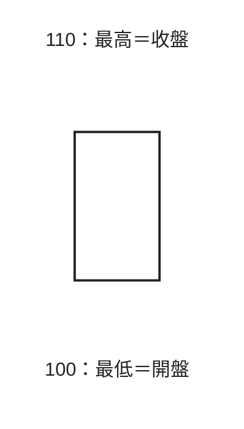

</details>

#### 第 2 題：一路走低

價格依序為 **110 → 108 → 105 → 102 → 100**。如果只是把第 1 題的方向反過來，K 線會改變哪個部分？

```mermaid
xychart-beta
    x-axis ["開盤", "時段一", "時段二", "時段三", "收盤"]
    y-axis "價格" 95 --> 115
    line [110, 108, 105, 102, 100]
```

<details>
<summary>看答案：</summary>
→ 長實心實體，沒有上下影線

**O＝110、H＝110、L＝100、C＝100。** 價格範圍與第 1 題相同，但收盤低於開盤，因此改為實心；實體上端是開盤，下端是收盤。

```mermaid
flowchart TB
    H["110：最高＝開盤"]
    B["⠀<br/>⠀<br/>⠀<br/>⠀"]
    L["100：最低＝收盤"]
    H ~~~ B ~~~ L
    classDef price fill:transparent,stroke:transparent,color:#222
    classDef filled fill:#222,stroke:#222,stroke-width:2px
    class H,L price
    class B filled
```

</details>

#### 第 3 題：先大跌，再拉回開盤附近

價格依序為 **104 → 96 → 100 → 103 → 105**。跌到 96 的那一段，應該畫成實體還是影線？

```mermaid
xychart-beta
    x-axis ["開盤", "時段一", "時段二", "時段三", "收盤"]
    y-axis "價格" 94 --> 114
    line [104, 96, 100, 103, 105]
```

<details>
<summary>看答案：</summary>
→ 小空心實體，帶長下影線

**O＝104、H＝105、L＝96、C＝105。** 實體只涵蓋開收盤的 104～105；96～104 是下影線，長度為 8。收盤就是最高價，所以沒有上影線。

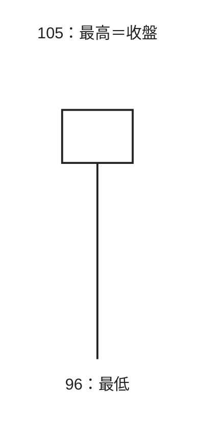

小方框代表 104～105 的實體，下方直線代表價格曾下探至 96。**曾經跌很深，不等於收盤仍跌很深。**

</details>

#### 第 4 題：先大漲，最後回落

價格依序為 **104 → 112 → 108 → 105 → 103**。112 應該放在實體的上端嗎？

```mermaid
xychart-beta
    x-axis ["開盤", "時段一", "時段二", "時段三", "收盤"]
    y-axis "價格" 94 --> 114
    line [104, 112, 108, 105, 103]
```

<details>
<summary>看答案：</summary>
→ 小實心實體，帶長上影線

**O＝104、H＝112、L＝103、C＝103。** 實體只有 103～104，且收盤低於開盤，所以填滿；104～112 是長度為 8 的上影線。收盤就是最低價，因此沒有下影線。

```mermaid
flowchart TB
    H["112：最高"]
    B["⠀"]
    L["103：最低＝收盤"]
    H ------ B
    B ~~~ L
    classDef price fill:transparent,stroke:transparent,color:#222
    classDef filled fill:#222,stroke:#222,stroke-width:2px
    class H,L price
    class B filled
    linkStyle 0 stroke:#222,stroke-width:2px
```

小方框代表 103～104 的實體，上方直線代表價格曾衝到 112。**曾經漲很高，不等於收盤仍漲很高。**

</details>

#### 第 5 題：繞了一圈，回到原點

價格依序為 **104 → 110 → 98 → 107 → 104**。開盤與收盤相同，是否代表今天沒有波動？

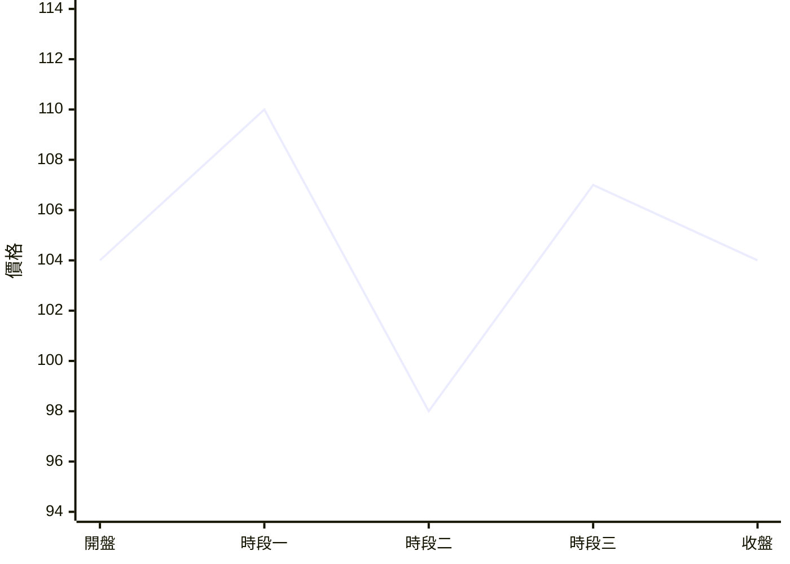

<details>
<summary>看答案：</summary>
→ 十字線，上下影線都存在

**O＝104、H＝110、L＝98、C＝104。** 開收盤相同，實體縮成一條橫線；上影線與下影線各長 6。開收盤沒有變化，仍可能經歷很大的盤中波動。

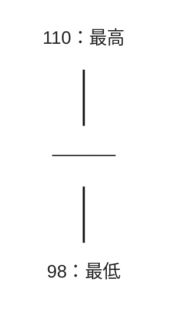

中間橫線是 104 的開收盤位置。K 線保留四個價格，卻省略過程；即使盤中走法不同，也可能形成同一根 K 線。

</details>

## K 線顏色：分清兩組比較

以下採用 **StockCharts 啟用 Color Prices 的空心 K 線規則**，各平台設定可能不同。

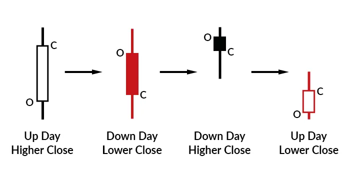


| 收盤與開盤比較 | 收盤與昨收比較 | 顯示方式 |
| --- | --- | --- |
| 高於開盤（空心） | 高於昨收（黑色） | 黑色空心 |
| 低於開盤（實心） | 低於昨收（紅色） | 紅色實心 |
| 低於開盤（實心） | 高於昨收（黑色） | 黑色實心 |
| 高於開盤（空心） | 低於昨收（紅色） | 紅色空心 |

**空心／實心看開收盤；外框與影線顏色看收盤與昨收。** 上表僅列原文說明的高低關係。

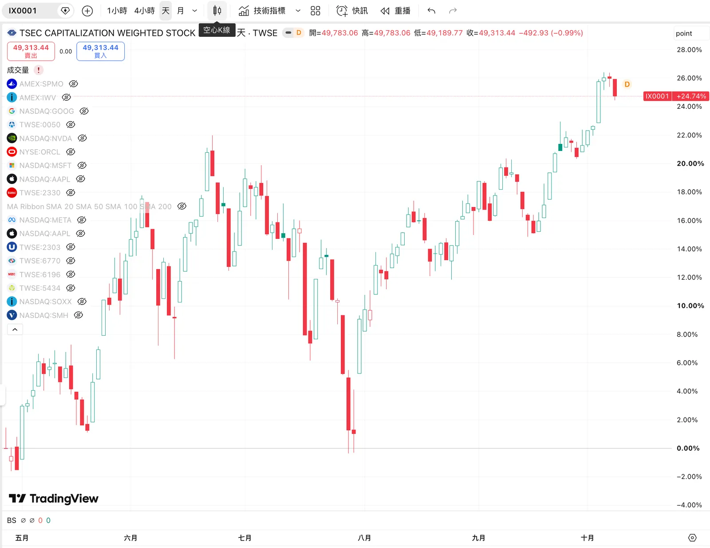
> TradingView 空心K線

## 從 K 線理解市場心理

- 黑色空心 - **收高且高於開盤**：買方較強；長實體顯示更強買盤。
- 紅色實心 - **收低且低於開盤**：賣方較強；長實體顯示更急迫賣壓。
- 黑色實心 - **跳空開高後回落、仍高於昨收**：初期買盤退潮，在漲勢後段可能偏空。
- 紅色空心 - **跳空開低後回升、仍低於昨收**：初期賣壓減弱，在跌勢中可能偏多。

判讀時需同時看開收盤、昨收與既有趨勢，避免只憑顏色判斷多空。

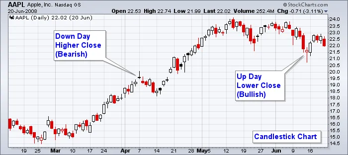

## 三種圖表的視覺比較

以下是原文以同一段 AAPL 行情繪製的三種圖表。

### 折線圖

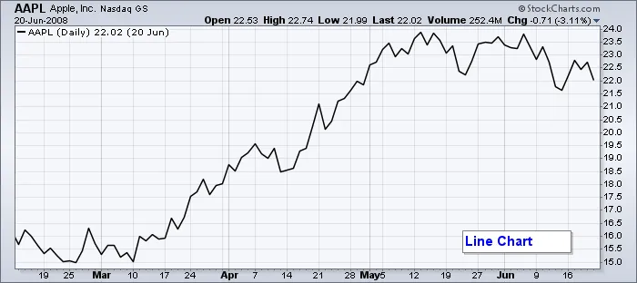

### OHLC 棒形圖（Open-High-Low-Close）Ch4.

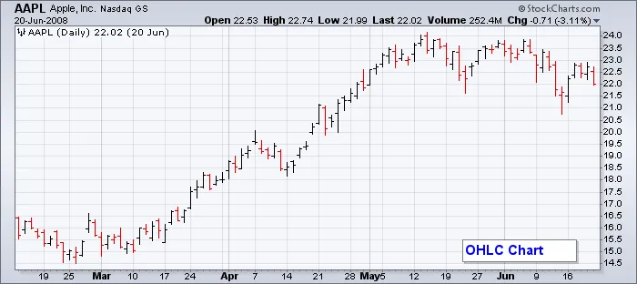

### K 線圖

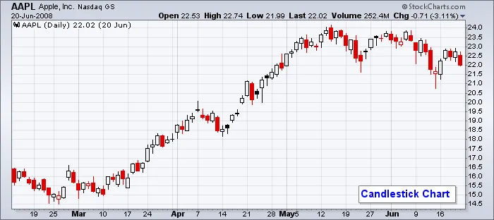
