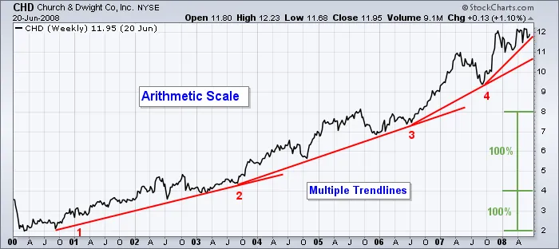
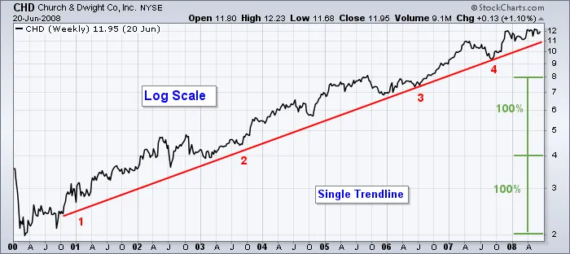
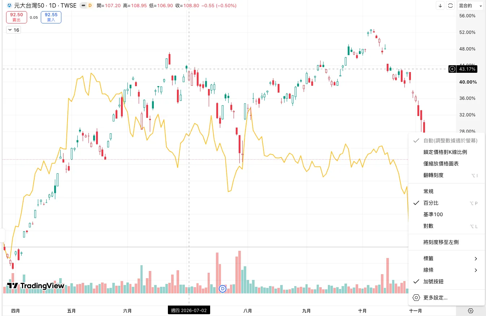
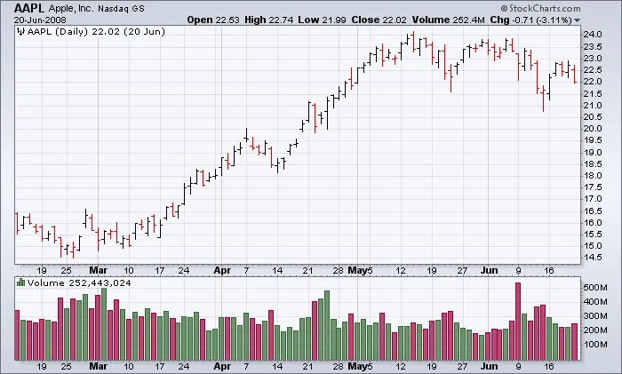
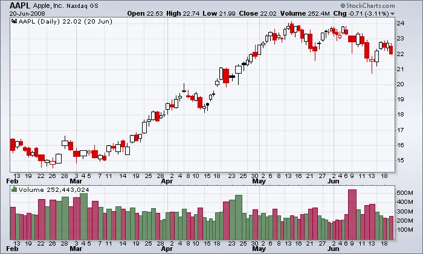

import BookmarkCard from '../../../../components/BookmarkCard.astro';

source: <BookmarkCard href="https://chartschool.stockcharts.com/table-of-contents/overview/technical-analysis-101/ta-101-part-6" title="ChartSchool：TA 101 – Part 6" />

---

延伸閱讀（補充刻度選擇與 CandleVolume 的計算方式）：

* <BookmarkCard href="https://chartschool.stockcharts.com/table-of-contents/chart-analysis/what-are-charts#price_scaling" title="ChartSchool：價格刻度與圖表基礎" />
* <BookmarkCard href="https://chartschool.stockcharts.com/table-of-contents/chart-analysis/chart-types/candlevolume" title="ChartSchool：CandleVolume 圖的構造與限制" />

:::tip[閱畢測驗 TEST！]

Q1：10 元漲到 20 元，與 20 元漲到 40 元，在哪種刻度下會畫成一樣高？線性or對數刻度

**A**：對數刻度。兩段都是上漲 100%，因此垂直距離相同；線性刻度比較價差，後一段上漲 20 元，是前一段 10 元的兩倍高。

Q2：一根很高的紅色成交量柱，代表「賣出股數比買進股數多」嗎？

**A**：不是。高度表示成交量大，紅色在本文設定中表示當期收盤低於前一期收盤。每筆成交都有買賣雙方，不能把整根紅色量柱當成只有賣方的交易。

Q3：CandleVolume 的 K 線很寬，是否表示開盤到收盤的價差很大？

**A**：不一定。寬度呈現成交量，實體的垂直長度才呈現開收盤價差；很寬但實體很短，仍可能是大量成交、開收盤卻相近的一天。

Q4：股價每隔一年依序為 100、120、144、172.8 元，線性圖越走越陡，代表報酬率正在加速嗎？

**A**：沒有。假設只比較這四個年度價格，各年的漲幅都是 20%，增加的是每年的金額：20、24、28.8 元。等時間、等百分比成長在對數刻度下會落在同一直線上；應先確認刻度，再判斷成長是否加速。

Q5：CandleVolume 出現很寬的紅色實心 K 線，並跌破畫好的趨勢線，就能確定接下來會續跌嗎？

**A**：不能。依本文配色，它表示成交量較大、收盤低於開盤，也低於前一期收盤；但 CandleVolume 的時間軸不等距，應先**用相同期間的一般 K 線或 OHLC 圖**確認是否也跌破「趨勢線」（月平均線 20MA、季平均線 60MA）。

這種伸縮會影響斜線與價格的相對位置，因此你看到的「跌破」，可能受到圖表畫法影響。

即使確認跌破，仍是已發生的量價現象，不能保證後續方向。

:::

## 價格刻度：同一段走勢，為什麼看起來不一樣？

看圖除了選擇折線、OHLC 或 K 線，也要確認縱軸如何安排價格。**線性刻度看價差，對數刻度看比例**；切換刻度不會改變實際成交價格，卻會改變走勢的外觀。

### 線性刻度（Arithmetic / Linear Scale）

相同金額的價差，畫成相同的垂直距離。例如 10 → 20 元與 20 → 30 元都是增加 10 元，在圖上會一樣高。

但 10 → 20 元與 20 → 40 元雖然都翻倍，後一段的價差是前一段的兩倍，因此在線性圖上也會畫得兩倍高。

### 對數刻度（Log Scale）

相同百分比的漲幅，畫成相同的垂直距離。10 → 20 元、20 → 40 元與 40 → 80 元都是上漲 100%，在對數圖上會一樣高。

上面兩張都是 **Church & Dwight（CHD）同一段週線行情**。在線性圖上，原文用三條趨勢線追蹤漲勢；改成對數圖後，一條線就能較好地描述整段上漲。

原文建議畫趨勢線時優先檢查對數刻度，尤其是長期圖。

> tradingview 裡「常規」是線性刻度。

## 成交量：除了價格，還有多少交易參與？

成交量（Volume）呈現一段期間內成交的數量。日線上的一根量柱對應一天，週線上的一根量柱則對應一週；量柱越高，代表該期間成交量越大。

啟用 **Color Volume** 後，量柱會依該期收盤相對前一期收盤的漲跌著色。

> ⚠️ 綠表示上漲日、紅色表示下跌日

:::note[蝸牛補充：紅色量柱不等於「只有賣出」]
本文圖中的量柱：
- 高度：成交量多少。
- 顏色：當期收盤相對前一期收盤的漲跌。
:::

## CandleVolume：用 K 線寬度呈現成交量

一般 K 線保留開盤、最高、最低、收盤四個價格；**CandleVolume 再用每根 K 線的寬度加入成交量資訊**。

* **實體的垂直長度**：開盤與收盤的價差。
* **上下影線**：實體之外的最高與最低價格。
* **K 線寬度**：成交量的相對大小，量大較寬、量小較窄。

對照下方量柱，可以看到成交量較大的日期，上方 K 線也比較寬。量能已經放進價格圖，因此熟悉這種圖表後，也可以省略下方量柱，讓畫面更簡潔。

延伸閱讀的計算說明指出，寬度反映該期成交量佔目前觀察區間總成交量的比例。因此它適合比較**同一張圖中的相對量能**，不宜直接拿不同觀察區間圖上的像素寬度比較絕對成交量。
