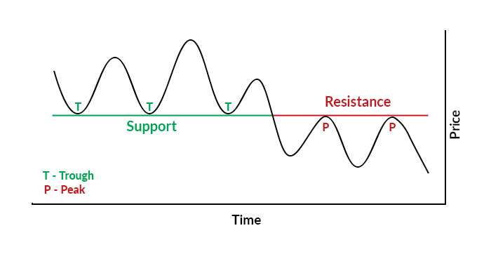
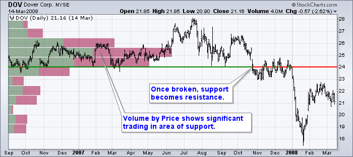
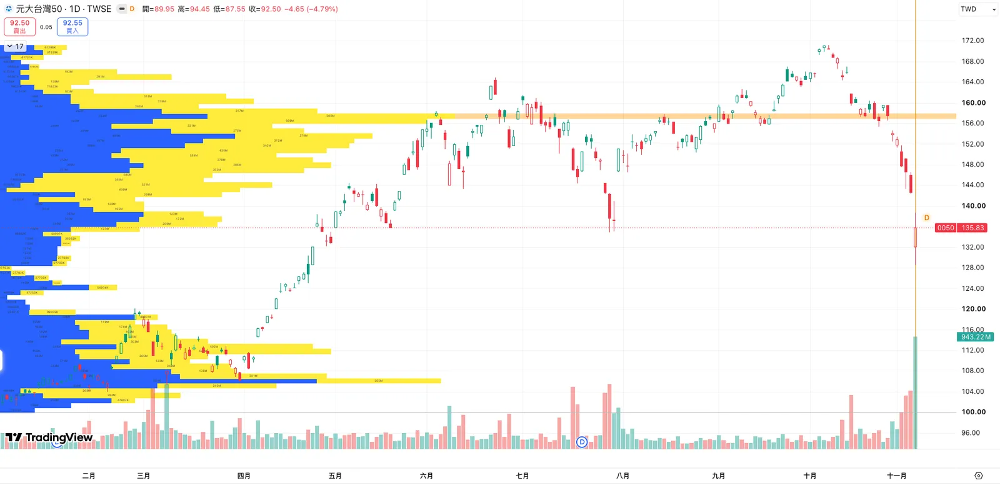
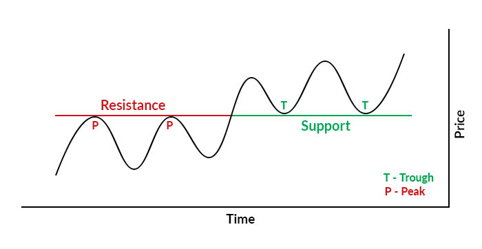
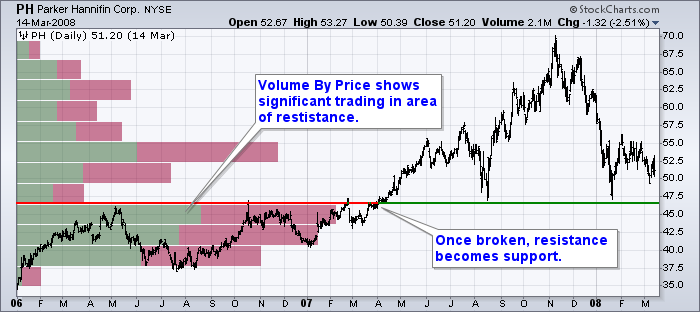

import BookmarkCard from '../../../../components/BookmarkCard.astro';

source: <BookmarkCard href="https://chartschool.stockcharts.com/table-of-contents/overview/technical-analysis-101/ta-101-part-7" title="ChartSchool：TA 101 – Part 7" />

---

延伸閱讀：

* <BookmarkCard href="https://chartschool.stockcharts.com/table-of-contents/chart-analysis/support-and-resistance" title="ChartSchool：支撐與壓力的判讀" />
* <BookmarkCard href="https://chartschool.stockcharts.com/table-of-contents/technical-indicators-and-overlays/technical-overlays/volume-by-price" title="ChartSchool：分價量的計算與使用限制" />

:::tip[閱畢測驗 TEST！]

Q1：支撐一定是精確到小數點的單一價格嗎？

**A**：不是。支撐與壓力都可能是一個價位，也可能是一段價格區域。過去曾在附近止跌，不代表每次都會在完全相同的價格反彈。

Q2：原本在 24 元附近的支撐被跌破，為什麼反彈回 24 元時，反而可能遇到賣壓？

**A**：先前在這一帶買進的人可能已經虧損，反彈接近買價時想賣出解套，因此原本的支撐可能變成壓力。這是市場心理的一種解釋，並非每位買方都一定會如此行動。

Q3：左側某個價位的分價量橫條很長，代表那裡目前有很多人持股，或買超很多嗎？

**A**：都不能直接推論。它表示所選圖表期間內，依該工具的計算方式歸入這個價格區間的歷史成交量較大；同一批股票可能反覆轉手，成交量也沒有直接提供目前持股人數或特定對象的買賣超。

Q4：股價突破原本 50 元附近的壓力區後漲到 55 元，拉回 50 元附近就一定會反彈嗎？

**A**：不一定。原壓力區是可能的新支撐，需要觀察回測時是否出現承接、價格是否止跌。先前賣出者想買回，只是可能的需求來源；突破後仍可能跌回原區間，不能把角色互換當成保證。

Q5：一張涵蓋 1～6 月的圖，顯示 24 元附近分價量最大，能說「3 月時就知道這裡的成交量最大」嗎？

**A**：不能。這個分價量包含 4～6 月才發生的交易；若要判斷 3 月當時能看到什麼，必須把圖表截止日期設在當時，再重新計算，避免用後來的資料解釋當時的決策。

:::

## 支撐與壓力：價格在哪裡容易停下來？

原文以恐懼與貪婪說明市場心理：價格變動會影響交易者對虧損、獲利與錯失機會的感受，進而改變他們願意買賣的價位。

* **支撐（Support）**：價格下跌到某個區域時，買盤承接增強，使跌勢暫時停住。
* **壓力／阻力（Resistance）**：價格上漲到某個區域時，賣壓增加，使漲勢暫時受阻。

兩者都可能維持數月，也都可能被突破。實務上常是一段**價格區域**，不必把它想成碰到就一定反轉的精確價位。

## 跌破支撐後，原支撐可能變成壓力

下圖中，價格原本多次在綠色水平線附近止跌，形成支撐。跌破之後，反彈卻在同一帶受阻，這個位置便轉為紅色標示的壓力。

圖中的 **T（Trough）是波谷，P（Peak）是波峰**。

原文提出的心理解釋是：先前在支撐區買進的人，跌破後面臨虧損；當價格回到買進成本附近，部分人可能選擇賣出解套，形成反彈時的供給。

### 跌破後的「壓力」「支撐」

這張圖可以依序看三件事：

1. **跌破之前**：綠色水平線約在 24 美元，價格曾在附近獲得支撐。
2. **跌破之後**：同一位置改以紅線標示，後續反彈未能有效站回，成為壓力。
3. **左側分價量**：附近存在較長橫條，說明圖表涵蓋期間有較多成交量歸入這些價格區間。

### 圖左側的橫條：分價量（Volume by Price）

上圖左側的橫向長條稱為分價量。

* 上一章的一般成交量柱：按**時間**彙整，例如每天成交多少股。
* 本章的分價量橫條：按**價格區間**彙整，橫條越長，表示該區間累計的成交量越大。

歷史交易較集中的區域，可能是後續供需變化值得注意的位置：**現價下方的長橫條可留意潛在支撐，現價上方的長橫條可留意潛在壓力**，仍須搭配實際價格反應。

StockCharts 的這項工具依圖表所顯示的整段期間計算，以各期收盤價所屬區間歸入該期成交量。因此它呈現的是依收盤價分組的分布，不是逐筆成交價格的完整明細。

:::note[蝸牛補充：分價量不等於目前持倉，也不是買賣超]

橫條累計的是歷史成交量，同一批股票可能已轉手多次。不能只看橫條長度，就認定目前有多少人套牢、多少人等待買回，或某個主力正在買超；這些身分與持倉資訊沒有直接呈現在圖上。

:::

### TradingView 技術指標：Volume Profile Visible Range

上圖使用 Investor_R 的 **Volume Profile Visible Range For All Accounts**，將可見範圍內的量價資料估算成各價格區間的成交量分布。

指標來源：<BookmarkCard href="https://www.tradingview.com/script/yLEjeo0J-Volume-Profile-Visible-Range-For-All-Accounts/" title="Investor_R：Volume Profile Visible Range For All Accounts" />

* **藍色 Blue＝Up volume**：作者預設將被演算法歸類為「向上價格移動」的成交量畫成藍色。
    以依 K 線開收盤方向分類的方法為例：某根 1 分鐘 K 線開盤 100 元、收盤 102 元、成交 1,000 股，就會把這 1,000 股歸入 Up volume。這是概念示例，此腳本的完整分類公式未公開。
* **黃色 Yellow＝Down volume**：作者預設將被歸類為「向下價格移動」的成交量畫成黃色。藍、黃兩段相加，才是該價區的估算總量；顏色可以自行修改。
* **橘色水平帶＝POC（Point of Control）**：標示可見範圍內估算總成交量最大的價格區間。它是交易集中的位置，不是所有人的平均成本，也不保證價格回來就會反彈。

**藍色、黃色 不表示買超/賣超**：僅表示「成交量」，每筆成交同時有買方與賣方。

#### → Up/Down Volume 投資人能做什麼解讀？
:::note[蝸牛補充：]
問一輪AI，我的結論是蠻難判斷 Up Volume 多就怎樣、Down Volume 多就怎樣，還是要看當下的情緒、漲跌幅、總量。
:::

- 強大的 Down Volume 卻跌不下去：
    - 當價格逼近某個支撐位時，成交量暴增且 Down Volume 佔絕大多數（代表市場有大量主動賣單、空頭猛烈攻擊），但價格卻奇蹟般地「跌不動」或迅速收腳。
    - 專業視角： 這是典型的「籌碼吸收（Absorption）」。代表檯面下有大型買盤（Smart Money）正在用限價單（Limit Orders）默默承接所有的拋壓。專業投資人看到這種現象，會高度警惕空頭陷阱，準備跟隨主力進場做多。

- 強大的 Up Volume 卻漲不上去：
    - 反之，在壓力位附近出現巨大的 Up Volume（買方不斷市價追買），但價格卻停滯不前。這暗示主力正在利用散戶的追高熱情悄悄倒貨（出貨），專業投資人會選擇減倉或順勢放空。

## 突破壓力後，原壓力可能變成支撐

反過來，價格原本多次漲到某個區域就回落；突破後，如果拉回時在這一帶獲得承接，原本的壓力就可能轉成支撐。

原文的心理解釋是：先前在壓力區賣出的人，看到價格繼續上漲，可能後悔賣得太早；等價格回到先前的賣價附近，就想買回，形成回檔時的需求。

### 突破後回測原壓力區

先觀察左半部的紅色水平線：價格曾多次在附近遇阻。突破後，同一水平位置改以綠線標示，後續回落時出現支撐；左側分價量則補充這一帶的歷史成交分布。

這些圖示呈現的是**可能的角色互換**。是否成立，要看突破後、再次接近該區域時的價格反應；僅僅穿過一條線，還不能預先確定之後必定守住或繼續突破。

## 回看歷史圖時，留意資料的截止日期

分價量會使用整張圖所涵蓋的資料。假設圖表顯示 1～6 月的行情，左側橫條也包含 6 月以前的全部資料，不能把它當成 3 月時就已經看得到的分布。

因此，上面的分價量適合協助閱讀整段歷史行情；若要檢驗「當時能否事先辨識支撐或壓力」，應把圖表截止日期設在當時，再重新觀察。

本文四張圖片均出自 StockCharts ChartSchool 的〈TA 101 – Part 7〉。下一章將介紹趨勢線與趨勢通道。
